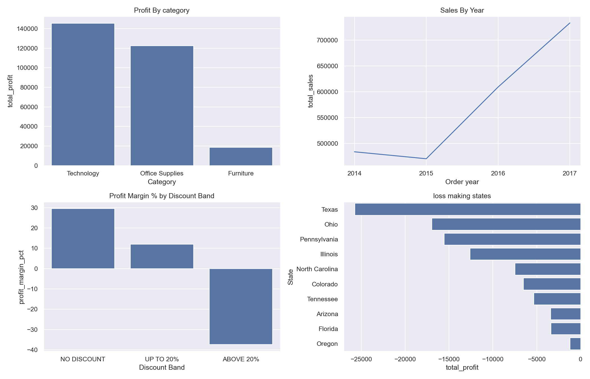

# Superstore Sales Analysis (Python)

## Business problem
Superstore wants to know which products, regions and customer segments make a profit, and where it is losing money.

## Dataset
Superstore sales data from Kaggle: 9,994 order lines and 21 columns (orders, customers, products, sales, quantity, discount, profit).

## Tools
Python, pandas, NumPy, matplotlib and seaborn, in a Jupyter notebook (VS Code).

## Data cleaning
Check, fix, verify. The raw table was never changed; all fixes were made on a copy.
- Checked for missing values, impossible numbers, bad dates, orders shipped before they were placed, and extra spaces
- Found 16 Product Name values with trailing spaces and trimmed them
- Removed 1 duplicate row (Row ID 3407, identical to Row ID 3406): 9,994 to 9,993 rows
- Converted Order Date and Ship Date from text to real dates, and Postal Code to text
- Verified: sales, profit and quantity totals differ from the raw table only by the removed row

## Analysis
19 business questions answered with pandas: totals and margins by category, region, segment, ship mode and year, top customers and products, loss-making sub-categories and states, discount bands, yearly growth, top 3 products per category, running totals, delivery times, and customer groups.

## Exploratory data analysis
- Summary statistics: Sales and Profit are right-skewed (median sales 54.48, but the 99th percentile is 2,481.94)
- Correlation: Discount and Profit -0.22, Sales and Profit 0.48; discounts have almost no link to sales or quantity (-0.03 and 0.01)

## Key findings
1. Furniture sells 741,718.42, almost as much as Office Supplies, but its margin is only 2.49%, against about 17% for Technology and Office Supplies.
2. Lines discounted above 20% have a margin of -37.34% and lose about 97 per line, while lines with no discount earn 29.51%.
3. 10 states lose money, led by Texas (-25,729) and Ohio (-16,959).
4. The loss-making sub-categories are Tables (-17,725), Bookcases (-3,473) and Supplies (-1,189).
5. Sales fell 2.78% in 2015, then grew every year to 733,215 in 2017.

## Recommendations
1. Cap discounts at 20%. Lines above 20% lost 135,364 in total.
2. Review pricing and discounts in the loss-making states, starting with Texas, Ohio, Pennsylvania and Illinois.
3. Review Furniture, especially Tables and Bookcases.

## Overall numbers
Orders: 5,009 | Sales: 2,296,919.49 | Profit: 286,409.08 | Profit margin: 12.47%

## Charts

## Files
- superstore_analysis.ipynb: the full notebook (cleaning, 19 questions, EDA, findings)
- images/key_findings.png: summary charts

